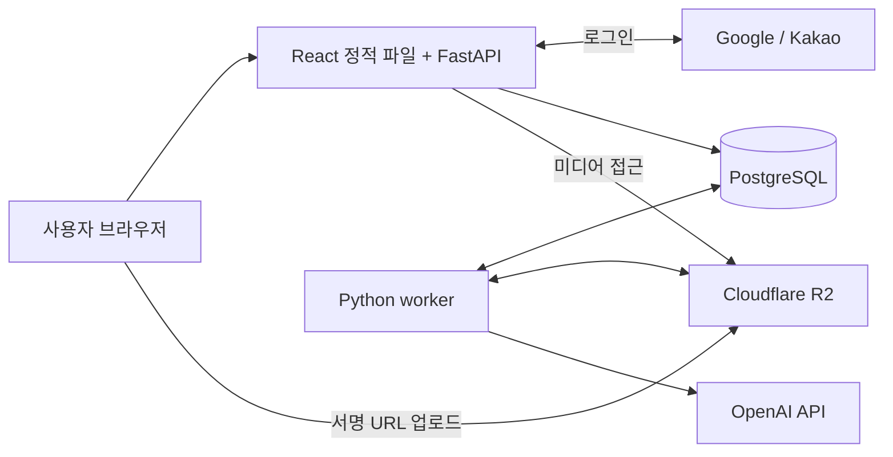

# Mori AI — 사진을 추억의 책으로

[프로젝트 기획서 (PDF)](01_AI_MORI_프로젝트_기획서.pdf) · [기능요구명세서 (PDF)](02_AI_MORI_기능요구명세서.pdf) · [발표자료 (PDF)](03_AI_MORI_발표자료.pdf)

Mori AI는 사진에 AI가 만든 한 문장 글귀를 더해 모바일 사진첩으로 감상하는 서비스입니다. 사용자가 고른 사진의 순서를 유지하고, 사진마다 한 페이지를 구성합니다. 생성된 글귀를 직접 다듬어 나만의 사진첩을 완성할 수 있습니다.

Google·Kakao 로그인부터 사진 업로드, AI 생성, 글귀 편집, 책장과 뷰어까지 연결했습니다. 사진 한 장으로 굿즈 시안을 만들고 수정·저장하는 확장 기능도 구현했습니다.

> **2026-10-19 기준:** Lightsail 서비스의 실제 연동·모바일 접속은 사용자 확인을 마쳤습니다. 이후 굿즈 및 최신 미디어 개선은 로컬 구현·검증 결과이며, 운영 배포 완료를 의미하지 않습니다.

## 주요 기능

| 기능 | 내용 |
|---|---|
| 로그인과 개인 책장 | Google·Kakao 로그인, 내 사진첩 조회·생성·삭제, 소유자 접근 제어 |
| 사진 업로드 | JPEG·PNG·WebP·HEIF/HEIC 지원, 순서 지정, 방향·촬영일 처리, 서버 검증 |
| AI 이미지 처리 | 신규 작업은 가로 사진을 세로 3:4로 변환하고, 세로·정사각형 사진은 정규화 이미지를 사용 |
| AI 글귀 | 사진의 시각적 단서를 바탕으로 담백한 회상형 한 문장 생성, 사용자 수정 |
| 모바일 뷰어 | 완성된 사진첩 감상, 배경음악 시작·반복 재생. 화면 이탈·백그라운드 전환 시 정지 |
| 굿즈 디자인 | 사진 한 장으로 시안 생성·수정·선택, 완성 저장, 내 디자인 조회와 앨범 연결 |

일반 공유, 결제, TTS·영상은 현재 범위에 포함하지 않습니다. 굿즈 제작 주문·PDF·메일도 후속 범위입니다.

## 팀원 및 역할

팀원 실명과 개인별 기여 정보는 저장소에 확정되어 있지 않아, 개발 기록의 역할을 기준으로 정리했습니다. 아래는 인원 명단이 아니며, Codex·Orca를 활용한 작업 배정과 통합 방식은 [개발 운영 문서](docs/개발운영.md)에 기록합니다.

| 역할 | 담당 업무 |
|---|---|
| 총괄·통합 | 요구사항·공통 계약 관리, 작업 분해·배정, 변경 검토와 통합 |
| 프론트엔드 | 책장·업로드·글귀 편집·뷰어·굿즈 화면, 브라우저 전처리 |
| 백엔드 | 인증·동의·소유권, HTTP API, DB와 상태 전이 |
| 미디어 | HEIF/HEIC 처리, 방향·색상 보정, WebP 정규화·썸네일·저장소 |
| AI·worker | OpenAI 연동, 생성 스케줄링, 동시성·재시도·실패 복구·비용 관리 |
| 검토·검증 | 계약·회귀·격리 검사, 브라우저 흐름과 성능·메모리 검증 |

## 기술 스택

저장소의 의존성·실행 설정 기준입니다. 정확한 패키지 버전은 [백엔드 lock](backend/requirements.lock)과 [프론트엔드 lock](frontend/package-lock.json)을 따릅니다.

| 영역 | 기술 |
|---|---|
| Frontend | React 19, TypeScript 5.9, Vite 7, React Router 7, TanStack Query 5 |
| Backend | Python 3.12, FastAPI, Pydantic 2, Uvicorn |
| Database | PostgreSQL 17, SQLAlchemy 2, asyncpg, Alembic |
| AI | OpenAI Python SDK, 글귀 `gpt-5.4-mini`, 사진첩 이미지 `gpt-image-2`, 굿즈 `gpt-image-2.5-sunburst` |
| Media | Pillow, pillow-heif, WebP, 브라우저 Canvas |
| Storage·Auth | Cloudflare R2(S3 호환·boto3), Google·Kakao OAuth |
| Infra | Docker Compose, AWS Lightsail, Caddy(HTTPS), Node.js 24 빌드 환경 |
| 검증·개발 도구 | pytest, 프론트엔드 테스트, Chromium 브라우저 검사, Codex·Orca |

모델명은 현재 프로젝트 기본 설정값이며 환경변수로 교체할 수 있습니다. 모델·프롬프트·처리 정책은 생성 작업 시작 시 고정해 진행 중인 작업의 동작을 보존합니다.

## 시스템 구조와 AI 활용



운영 환경에서는 Caddy가 HTTPS 요청을 web 서비스로 전달합니다. FastAPI가 React 빌드와 `/api/v1`을 같은 origin에서 제공하며, 별도 worker가 DB에 저장된 작업을 가져와 검증·생성을 처리합니다. Redis·Celery 없이 PostgreSQL 기반 작업 점유와 상태 관리로 구성했습니다.

### 사진에서 사진첩까지

1. **업로드·전처리:** 브라우저에서 지원 가능한 사진을 축소하고 본문·썸네일을 준비합니다. HEIC 등은 서버 처리로 전환하며, 서버가 파일 형식·크기·방향을 검증합니다.
2. **정규화:** 신규 예약은 긴 변 2,048px·WebP 품질 85·최대 1,000,000bytes를 기본값으로 고정합니다. 조건에 맞는 전처리 결과는 재사용하며, 복잡한 사진은 용량 상한에 맞춰 더 작게 축소될 수 있습니다.
3. **이미지·글귀 생성:** 새 작업은 가로 사진에만 이미지 AI를 호출합니다. 글귀는 AI 변환 결과가 아닌 정규화된 업로드 사진을 보고 생성합니다. 회상형 프롬프트 `openai-memory-v3`는 사진에 없는 관계·장소·사연을 지어내지 않도록 설계했습니다.
4. **편집·완성:** 사용자가 글귀를 수정한 뒤 사진첩을 완성하고 책장·모바일 뷰어에서 감상합니다.

새 작업은 이미지 2·글귀 4·최적화 1의 동시 처리 한도를 사용합니다. 이미지 전역 한도 2는 사진첩과 굿즈가 공유합니다. 기존 작업의 저장된 설정과 이전 정책은 유지하며, 기존 설정이 4인 경우에도 새 실행은 전역 한도 2를 적용합니다. 업로드 검증은 worker 프로세스당 1개입니다.

AI 호출 전 비용을 예약하고 결과를 원장에 기록합니다. 전송 결과가 불명확한 호출은 자동 재호출하지 않으며, SDK 자동 재시도도 비활성화했습니다. 이 서비스의 AI는 이미지 변환·글귀·굿즈 생성에 사용하며, RAG·벡터 DB·대화형 장기 기억은 구현하지 않았습니다.

## 실행 방법

### 1. 새 로컬 환경 준비

Docker Desktop 또는 Docker Engine과 Compose, `make`가 필요합니다. Python·Node.js는 Docker 빌드 안에서 준비합니다.

저장소 루트에서 **기존 `.env`가 없는 경우에만** 예시를 복사합니다.

```sh
cp .env.example .env
```

`.env`에서 아래 값을 설정하면 외부 계정 없이 개발 로그인·가짜 AI·로컬 저장소로 실행할 수 있습니다. 가짜 AI는 고정 글귀와 테스트 이미지를 사용합니다.

```dotenv
COMPOSE_PROJECT_NAME=mori_ai_local
POSTGRES_PASSWORD=replace_with_your_local_password
WEB_PORT=18000
APP_ORIGIN=http://127.0.0.1:18000
APP_ENV=local
DEV_AUTH_ENABLED=true
SESSION_COOKIE_ALLOW_INSECURE_LOCAL=true
DEV_AI_ENABLED=true
AI_REAL_CALLS_ENABLED=false
STORAGE_MODE=local
```

비밀번호는 새 로컬 전용 값으로 바꾸며 영문·숫자·밑줄·하이픈을 사용합니다. 다른 환경과 Compose 프로젝트명·포트가 겹치지 않게 지정합니다.

### 2. 시작과 종료

```sh
make up
# 브라우저에서 http://127.0.0.1:18000 접속

make down
```

`make up`은 이미지 빌드, PostgreSQL 준비, Alembic migration을 거쳐 web·worker를 시작합니다. `make down`은 DB·미디어 volume을 보존합니다. BGM은 `assets/audio/bgm.mp3`를 이미지에 포함해 `/audio/bgm.mp3`로 제공합니다.

### 3. 실제 외부 서비스 연결

[환경변수 예시](.env.example)의 항목을 서비스 전용 값으로 채웁니다.

| 연결 | 설정 |
|---|---|
| Google·Kakao | 각 Client ID·Secret·Redirect URI 설정. OAuth callback은 `APP_ORIGIN`과 같은 origin 사용 |
| Cloudflare R2 | `STORAGE_MODE=r2`, bucket·endpoint·접근 키 설정, 브라우저 origin에 대한 bucket CORS 등록 |
| OpenAI | `OPENAI_API_KEY` 설정, `DEV_AI_ENABLED=false`, `AI_REAL_CALLS_ENABLED=true` |

실제 AI 호출에는 비용이 발생합니다. 현재 프로젝트의 승인 총 한도는 USD 100, 초기 운용 한도는 USD 5이며 소비 목표가 아닙니다. 누적 원장을 보존하고, 실제 사용 가능 한도와 모델 설정을 확인합니다. 키는 프론트엔드 환경변수나 Git에 넣지 않습니다.

R2 CORS 예시는 [로컬 설정 JSON](docs/storage/r2-cors.local.json)을 참고해 실제 origin에 맞춥니다. `localhost`와 `127.0.0.1`, 서로 다른 포트는 별개 origin입니다. 로컬 저장소를 사용하던 DB를 R2 모드로 바꾸는 자동 이관은 제공하지 않습니다.

기존 QA는 `.env.qa`·Compose project `mori-r2-qa`·포트 8000을 사용합니다. 위 새 로컬 환경과 분리하고 QA의 DB·사진·OAuth 설정을 보존합니다. Lightsail 실행·HTTPS·승인 계정·백업 절차는 [배포 문서](docs/Lightsail-배포.md)를 따릅니다. 운영에서는 개발 로그인과 insecure cookie를 비활성화합니다.

## 구현 및 검증 결과

아래는 **기존 검증 기록의 요약**입니다. 로컬 코드의 검사 결과, 실제 외부 연동, 사용자 확인을 구분했습니다.

| 항목 | 확인한 결과 | 근거 |
|---|---|---|
| 실제 로그인·저장소·AI | Google·Kakao 로그인, R2 업로드·읽기, OpenAI 글귀·사진첩 이미지 생성 연결 | [OAuth](docs/실제OAuth-검증결과.md), [R2](docs/R2-통합검증.md), [AI·비용](docs/실제-AI-검증.md) |
| 배포·모바일 접속 | 2026-10-18 사용자로부터 Lightsail 실제 연동·모바일 접속 성공 보고 | [배포 절차](docs/Lightsail-배포.md), [작업 기록](AGENTS.md) |
| 굿즈 실제 생성 | 합성 사진으로 투명 배경 시안 생성·수정, R2 저장·재조회·소유권 검증 | [굿즈 실제 연동](docs/굿즈-실제연동-검증.md) |
| 최신 기능 회귀 | backend 전체 967개 통과, frontend 132개 통과, TypeScript·Vite production build 성공. 추가 집중 검사는 중복 합산하지 않음 | [셋째 묶음 검증](docs/미디어-셋째묶음-검증.md) |
| 전송·처리 개선 | 작업별 원본 다운로드 3회→1회, 전처리 본문·썸네일 조건부 재사용, 가로 전용 AI 적용 | [성능 검증](docs/성능-검증결과.md), [첫째](docs/미디어-첫묶음-검증.md)·[둘째 묶음](docs/미디어-둘째묶음-검증.md) |
| 합성 화질·메모리 비교 | 12MP JPEG 출력 2,430,018B→604,338B. 2GiB 예산의 분할 컨테이너 검사에서 병렬 4의 유휴 RSS 증가 18.21%로 운영 권고 보류 | [최소 메모리 검증](docs/미디어-최소메모리검증.md) |

메모리 비교는 모의 AI 응답을 사용하는 로컬 시험이며 실제 OpenAI 처리 속도나 운영 OS 전체의 메모리 수용을 보장하지 않습니다. 병렬 2·4 양쪽에서 검증 driver의 메모리 한도 접촉이 발생해 엄격 인수 기준은 미통과했습니다. 최신 구현의 기능 검사 통과를 운영 병렬 4의 안전성으로 해석하지 않습니다.

### 검증 명령

```sh
make verify-install       # 검증 이미지 빌드, 의존성·기본 테스트
make verify-isolation     # 임시 Compose 환경 격리
make verify-codecs        # 이미지 codec
make verify-db            # 전용 임시 PostgreSQL 통합 검사
make verify-worker        # worker 동작
make verify-media-load    # 순차 미디어 부하 검사
```

전체 backend 검사는 설치 검증에서 만든 이미지를 지정해 실행할 수 있습니다.

```sh
MORI_VERIFY_TEST_IMAGE=mori-ai:verify-tests bash scripts/verify-db.sh backend/tests
```

기존 `mori-ai:ai-tests` 이미지를 사용하는 경우 해당 이름으로 바꿉니다. 검사 DB는 QA와 분리하며 종료 시 자신의 임시 볼륨만 정리합니다. 실제 R2 검사인 `make verify-storage`는 전용 설정에서 합성 객체를 생성·검증·삭제하며 외부 저장소 요청이 발생합니다.

### 남은 검증과 제한

- 최신 미디어·굿즈 변경의 운영 배포 및 배포 후 실제 사진 업로드·R2 CORS 확인. 별도 굿즈 로컬 origin 18183의 직접 업로드 CORS 재검증은 보류 상태입니다.
- 실제 iPhone·WebKit, 모바일 전처리 화질·네트워크 중단/복귀·BGM 청취 확인.
- 2GB 환경 장시간 부하, 반복 후 worker 잔류 메모리 분석, 검증 driver 메모리 압박 해소와 백업 복구.
- HDR·10bit 입력은 미지원입니다. 고해상도 입력은 형식·메모리 제한에 따라 거절될 수 있습니다.
- 실제 인물·반려동물의 굿즈 품질 확인, 명세 기준 최소 5명 사용자 테스트·피드백 반영과 제출 자료 정리.

## 문서와 코드 안내

| 경로 | 내용 |
|---|---|
| `frontend/` | React 화면, API 클라이언트, 업로드 전처리와 테스트 |
| `backend/` | HTTP API, 도메인·repository, AI·미디어 adapter, worker, migration·테스트 |
| `scripts/` | 로컬 검증, 배포·백업 도구 |
| `assets/audio/` | 뷰어 배경음악 |
| `docs/` | 계약·설계·운영·검증 근거 |

| 문서 | 내용 |
|---|---|
| [기능요구명세서](기능요구명세서.md) | 제품 목적·기능·제외 범위·사용자 테스트와 제출 조건 |
| [공통계약 v1.11](docs/공통계약-v1.md) · [샘플](docs/공통계약-v1.examples.json) | 현재 API·DTO·상태·오류·미디어 정책 |
| [굿즈 계약](docs/굿즈-공통계약-v1.md) | 굿즈 생성·수정·저장과 앨범 연결 |
| [설계](docs/설계.md) | 화면·시스템 구조·worker·복구 설계 |
| [재사용 조사](docs/재사용조사.md) | 기존 moriai 참고·이식 코드의 출처와 채택 조건 |
| [검증 계획](docs/검증계획.md) | 인수 기준과 남은 확인 항목 |
| [개발 운영](docs/개발운영.md) · [AGENTS.md](AGENTS.md) | 역할·편집 소유권·환경 격리·협업 규칙 |
| [UI 통합 검증](docs/UI-통합검증.md) · [BGM 검증](docs/BGM-구현검증.md) | 화면 통합 및 음악 재생 확인 |
| [쌍 업로드 검증](docs/업로드-쌍-호환성-검증.md) · [미디어 전처리 검증](docs/미디어-전처리-검증.md) | 최신 미디어 개선의 선행 구현과 호환성 |
| [문서 이력](docs/archive/2026-10-16/README.md) | 과거 설계·검토 기록 |

과거 문서의 미구현 표기나 정책은 당시 이력입니다. 현재 계약과 최신 검증 결과를 우선하며, 이전 예약·생성 작업에는 저장된 설정을 유지합니다.
