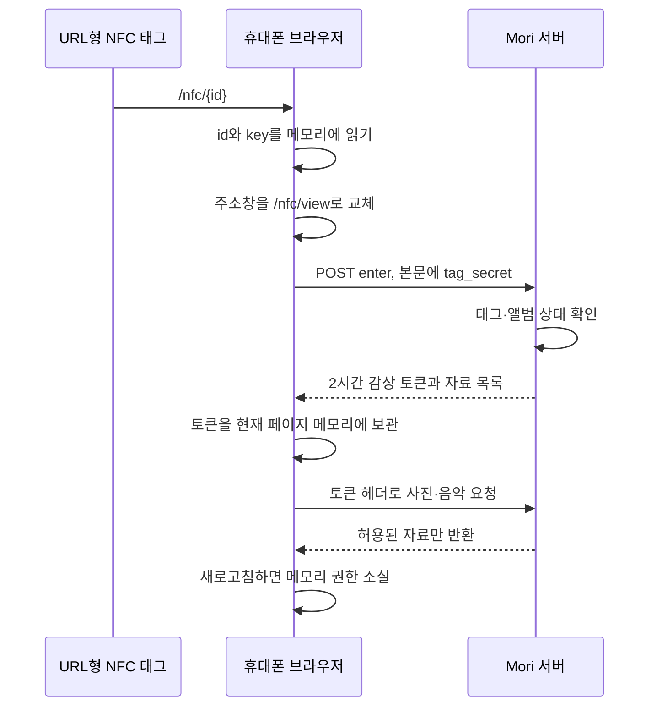

# Mori NFC 감상 접근을 제한하는 우회 방식 — 보관용 설계 메모

- 작성일: 2026-10-27
- 목적: 일반 URL형 NFC 태그로 감상 진입을 유도하는 방법을 추후 검토할 수 있도록 보관한다.
- 상태: 현재 구현의 설명과 향후 검토안을 기록한 참고 문서다. 이 문서 작성으로 기능을 새로 적용하거나 서비스 설정을 변경하지 않는다.
- 구현 대조 기준: `mori_ai`의 `a84cea9` 및 QA 조사 기록 `d12599b`.
- 문서의 주소·ID·비밀키는 모두 설명용 자리표시자다. 실제 태그 주소, 운영자 자료, 사용자 사진, 자격증명은 포함하지 않는다.

## 1. 이 방식이 해결하려는 문제

사용자가 굿즈를 태그하면 추억책이 열리고, 감상 중 주소창에 보이는 주소를 다른 사람에게 보내더라도 그 사람에게 바로 앨범이 열리지 않게 하고 싶다.

이를 위해 **태그에 기록하는 진입 주소**와 **감상 중 주소창에 표시하는 주소**를 분리한다. 감상 권한은 해당 페이지가 살아 있는 동안만 메모리에 둔다.

이것은 ‘일반 사용자가 감상 주소를 복사해 공유하는 일을 줄이는 방법’이다. **일반 URL 태그만으로 실제 NFC 접촉을 증명하거나 원래 태그 주소의 복사를 막을 수는 없다.**

| 구분 | 이 방식의 성질 |
|---|---|
| 감상 중 주소만 복사해서 새 창에 열기 | 권한이 없어 앨범 자료를 받지 못함 |
| 감상 화면 새로고침 | 메모리의 권한이 사라져 재태그 안내 |
| 태그에 기록된 원래 주소 전체를 복사해 열기 | 태그가 활성 상태라면 다시 권한을 발급받을 수 있음 |
| 태그를 계속 휴대폰에 붙이고 있는지 확인 | 하지 못함 |
| 감상 화면 캡처·받은 이미지 복사 방지 | 보장하지 못함 |
| 사진 추가·삭제 권한 제한 | 로그인 기반 관리 권한으로 별도 처리 |

## 2. NFC가 링크를 여는 과정과 웹 인증의 경계

URL형 NFC 태그에는 웹 주소를 담은 NDEF 레코드를 기록한다. 휴대폰이 이를 읽고 사용자가 알림을 선택하면 브라우저나 연결된 앱이 그 주소를 연다. Apple은 백그라운드 읽기에서 URI 레코드를 처리하고, Universal Link에 연결된 앱이 없으면 Safari에서 연다고 설명한다. 단말 상태에 따른 읽기 제한도 있다. [Apple: Background Tag Reading](https://developer.apple.com/documentation/CoreNFC/adding-support-for-background-tag-reading)

이후 일반 웹 서버가 받는 HTTP 요청에는 ‘물리적인 NFC 태그에서 왔음’을 보증하는 표준 인증서가 붙지 않는다. 같은 주소를 직접 입력하거나 다른 사람에게 전달해 열어도 사이트는 같은 진입으로 처리한다.

따라서 아래 원리를 구분해야 한다.

- NFC: 주소를 전달하는 수단.
- 웹의 비밀키 검사: 그 주소에 포함된 비밀을 알고 있는지 확인하는 수단.
- 페이지 메모리의 감상 권한: 현재 열린 페이지에서 앨범 자료를 받을 수 있게 하는 수단.

`Origin`, `Referer`, `User-Agent`, ‘NFC에서 열었음’ 같은 임의 파라미터만으로 실제 접촉을 증명할 수 없다. Origin 검사는 다른 사이트에서의 요청을 제한하는 보조 장치이고, 전용 클라이언트가 헤더를 보내는 것까지 막는 인증은 아니다.

## 3. 주소와 두 종류의 비밀

### 3.1 태그에 기록하는 진입 주소

```text
https://service.example/nfc/{tag_id}#key={tag_secret}
```

- `tag_id`: 어떤 태그인지 찾는 공개 식별자. 앨범을 여는 비밀 자체가 아니다.
- `tag_secret`: 태그별로 발급하는 충분히 긴 무작위 비밀. 이를 가진 사람은 진입 권한을 요청할 수 있다.
- `#key=...`: URL fragment다. 보통 HTTP 요청 경로에는 실리지 않고, 페이지 JavaScript가 읽는다.

현재 구현은 `secrets.token_urlsafe(32)`로 비밀을 만든다. 태그를 다시 기록할 수 있도록 DB에 원문 `write_token`과 검증용 SHA-256 `token_hash`를 함께 보존한다. **현재 태그 비밀을 DB에 hash만 저장한다고 설명하면 부정확하다.** 원문 보관에 대한 접근 통제가 필요하다.

fragment 사용은 서버의 일반 URL 로그에 비밀이 들어갈 가능성을 줄인다. 그러나 원래 주소를 읽는 NFC 앱, OS 알림·공유 기능, 브라우저 환경, 페이지의 스크립트 등에서 비밀이 절대 노출되지 않는다는 뜻은 아니다.

### 3.2 서버가 발급하는 감상 권한

태그 비밀을 확인한 서버가 별도의 무작위 `session_token`을 발급한다.

- 현재 유효기간은 발급 시점부터 최대 2시간이다. 활동할 때마다 연장하는 구조가 아니다.
- 감상 토큰의 hash만 DB에 저장한다.
- 해당 태그·앨범 버전·허용된 결과 이미지와 썸네일에 범위를 제한한다.
- 로그인 세션이나 사진 관리 권한으로 사용하지 않는다.

태그 비밀과 감상 토큰은 서로 대체할 수 없다. 태그 비밀을 이미지 요청 헤더에 넣는 것만으로는 이미지를 받을 수 없지만, 태그 비밀로 감상 토큰을 새로 요청하는 것은 가능하다.

## 4. 전체 처리 순서



### 단계 A. 초기 주소를 읽고 주소창에서 비밀 제거

현재 프론트는 처음 렌더링할 때 태그 ID와 fragment의 비밀을 읽어 React ref에 보관한다. 이어서 다음과 같이 주소를 교체한다.

```js
const entry = captureEntry(); // 주소를 바꾸기 전에 읽어야 한다.
history.replaceState(history.state, '', '/nfc/view');
```

`replaceState`는 이 호출 자체로 문서를 다시 내려받지 않으므로 현재 JavaScript 메모리는 유지된다. 이때 비밀이 브라우저·운영체제의 모든 과거 기록에서 삭제되는 것은 아니다.

현재 구현에서는 태그 비밀도 최초 entry ref에 남는다. 주소창에서 지웠다고 모든 메모리에서 태그 비밀을 지웠다고 설명해서는 안 된다. 실패 후 재시도에 쓰이는 값이며, 향후 보관 시간을 줄일 때 재시도 정책과 함께 검토해야 한다.

### 단계 B. 태그 비밀로 감상 권한 요청

```http
POST /api/v1/nfc/tags/{tag_id}/enter
Content-Type: application/json
Origin: https://service.example

{"token":"TAG_SECRET_PLACEHOLDER"}
```

현재 서버는 다음을 확인한다.

1. 요청 Origin이 서비스 Origin과 일치하는지 확인한다.
2. 활성 태그와 연결된 구매·삭제되지 않은 앨범을 찾는다.
3. 태그 비밀의 hash를 저장된 hash와 상수 시간 비교한다.
4. 앨범이 공개 완료 상태이고 관리계정 등록 대기가 아닌지 확인한다.
5. 결과 페이지·이미지·썸네일·글귀가 준비됐는지 검증한다.

완성 전에는 `{state:"preparing"}`만 반환하고 감상 세션은 만들지 않는다. 준비가 끝났으면 다음 형태를 반환한다.

```json
{
  "state": "ready",
  "session_token": "VIEWING_TOKEN_PLACEHOLDER",
  "expires_at": "2030-01-01T12:00:00+00:00",
  "album_title": "우리의 추억",
  "pages": [
    {
      "id": "PAGE_ID_PLACEHOLDER",
      "text": "함께한 시간이 떠오른다.",
      "src": "/api/v1/nfc/media/{result_asset_id}",
      "thumb": "/api/v1/nfc/media/{thumbnail_asset_id}"
    }
  ],
  "music_url": "/api/v1/nfc/music"
}
```

설명 편의를 위한 데이터 부분 예시이며 실제 HTTP 공통 envelope는 생략했다. 사진 업로드·삭제·선물 등록 권한은 반환하지 않는다.

### 단계 C. 토큰을 현재 페이지 메모리에만 보관

```js
// 개념 설명용. 현재 제품 코드는 React ref와 AbortController 등을 사용한다.
let viewingToken = response.session_token;

// cookie, localStorage, sessionStorage, URL에는 감상 토큰을 저장하지 않는다.
```

쿠키에 토큰을 보관하지 않으므로 감상 요청은 `credentials: 'omit'`으로 보낸다. 다만 ‘NFC 감상이 로그인 쿠키를 사용하지 않는다’와 ‘브라우저에 기존 로그인 쿠키가 전혀 없다’는 서로 다른 이야기다. 기존 관리 로그인은 별도로 남을 수 있다.

메모리에만 둬도 같은 페이지에서 실행되는 악성 스크립트나 개발자 도구가 토큰에 접근할 가능성은 남는다. XSS 방어·외부 스크립트 통제가 함께 필요하다.

### 단계 D. 자료를 받을 때마다 권한 검사

```http
GET /api/v1/nfc/media/{asset_id}
X-Mori-Viewer-Token: VIEWING_TOKEN_PLACEHOLDER
```

현재 서버는 감상 세션의 존재·만료·폐기 여부, 태그 활성 상태, 앨범 공개 상태·삭제·관리 등록 대기·버전 일치를 검사한다. 요청한 asset이 해당 세션의 허용 목록에 있고 같은 앨범·소유자에 속한 준비된 자료인지도 검사한다.

미디어 원본 저장소의 장기 URL을 노출하지 않고 인증된 API가 bytes를 전달한다. 프론트는 받은 Blob으로 임시 URL을 만들어 표시한다. 응답에는 `Cache-Control: private, no-store`, `Referrer-Policy: no-referrer` 등을 적용한다.

이 구조에서 ‘뷰어 페이지 접속 제한’은 주로 **앨범 데이터와 미디어의 접근 제한**을 뜻한다. `/nfc/view`의 HTML과 앱 코드는 열릴 수 있고, 권한이 없으면 안내만 표시한다. HTML 자체를 비밀로 만드는 구조는 아니다.

### 단계 E. 새로고침·종료·만료

새로고침하면 기존 JavaScript 메모리가 사라진다. 다시 열린 주소에는 태그 비밀도 없으므로 감상 권한을 새로 요청할 수 없다. 따라서 재태그 안내를 표시한다.

종료 시에는 가능한 범위에서 `/api/v1/nfc/close`로 감상 세션을 폐기하고 다운로드 취소·Blob 해제·책 renderer와 음악 정리를 한다. 페이지가 강제 종료되거나 네트워크가 끊기면 종료 요청은 도착하지 않을 수 있어 서버 만료로 보완한다. 모바일 백그라운드·페이지 복원 동작은 별도 실기기 확인이 필요하다.

**2시간 뒤 이미 내려받은 자료까지 회수되는 것은 아니다.** 현재 뷰어는 전체 사진·음악을 미리 받는다. 서버 만료는 이후 요청을 차단하고 정상 클라이언트는 자료를 정리하지만, 저장하거나 캡처한 자료까지 지우지는 못한다.

## 5. 실제로 가능한 우회와 효과의 한계

| 상황 | 결과와 이유 |
|---|---|
| 감상 중 주소창의 `/nfc/view`만 전달 | 받는 사람에게 태그 비밀·감상 토큰이 없어 자료를 못 받음 |
| 감상 중 새로고침 | 메모리 권한이 없어져 재태그 필요. 이용자에게 불편이 될 수 있음 |
| 원래 `/nfc/{id}#key=...` 전체를 전달 | 받는 사람도 새 감상 권한을 요청할 수 있음 |
| NFC 내용을 다른 URL 태그에 그대로 복사 | 같은 원래 주소가 열려 동일하게 진입 가능 |
| 감상 토큰을 직접 추출해 전달 | 토큰이 유효한 동안 허용 범위의 자료 접근 가능 |
| 만료 후 원래 태그 주소로 다시 진입 | 태그가 활성 상태이면 새 토큰 발급 가능. 태그 비밀 자체는 2시간 만료가 아님 |
| 계정 로그인 없이 사진 관리 시도 | 감상 토큰만으로 관리 API를 사용할 수 없음 |
| 스크린샷·화면 녹화·받은 bytes 저장 | 이 설계만으로 방지 불가 |

태그 주소를 아는 사람의 재진입을 막으려고 같은 정적 비밀을 한 번만 허용하면 정상 사용자의 두 번째 태그도 막힌다. **일반 읽기 전용 URL 태그의 주소는 웹 서버가 자동으로 갱신할 수 없기 때문이다.** 일회용 URL과 무한 재태그를 함께 구현하려면 태그·앱·프로토콜을 바꿔야 한다.

## 6. 추후 이 방식을 다시 검토할 때의 구성 순서

1. **목표를 먼저 정한다.** ‘주소창 링크의 손쉬운 공유 감소’인지 ‘실제 태그 접촉의 검증’인지 구분한다. 전자라면 이 방식이 후보가 될 수 있다.
2. **새로고침 정책을 정한다.** 매번 재태그할지, 일정 시간 동안 복원할지 결정한다. 후자는 sessionStorage나 세션 쿠키 등 다른 보관 정책이 필요하고, 현재의 메모리 전용 성질도 달라진다.
3. **감상과 관리를 분리한다.** NFC는 읽기 전용, 관리 QR은 로그인·소유권 확인을 유지한다. NFC 진입만으로 소유권을 이전하지 않는다.
4. **영구 HTTPS 도메인을 준비한다.** 개발용 LAN IP·localhost·단기 인증서를 실제 제작 태그에 기록하지 않는다. 호스트가 바뀌어도 유지할 진입 주소와 태그-앨범 매핑을 설계한다.
5. **태그별 비밀을 발급한다.** 순번·앨범 ID·이메일을 비밀 대용으로 사용하지 않는다. 원문 재조회가 필요하면 저장·메일 첨부·제작 도구의 접근 범위를 함께 정한다.
6. **서버의 모든 미디어 경로를 점검한다.** 화면에서 링크를 숨기는 데 그치지 않고, 원본·썸네일·음악·다운로드·기존 viewer API 등 우회 경로에서도 같은 접근 정책이 지켜지는지 확인한다.
7. **폐기·재발급을 설계한다.** 분실 태그를 비활성화하면 복제된 같은 비밀도 함께 차단된다. 새 비밀 발급 후 기존 실물은 다시 기록해야 할 수 있다. 이미 발송한 첨부 파일의 비밀을 회수할 수는 없다.
8. **운영 방어를 추가 검토한다.** 태그별 발급 속도·남용 제한, 최소 진단 로그, 키 접근 감사, 외부 스크립트 최소화 등을 설계한다. 이 항목들을 현재 모두 구현한 것으로 해석하지 않는다.
9. **실기기와 실제 태그로 검증한다.** 휴대폰 Safari/Chrome의 URL fragment 전달·새로고침·복귀·기억장소·소리·대용량 메모리를 확인한다.

## 7. 더 강한 NFC 접촉 검증으로 확장하는 후보

### 7.1 동적 인증 URL을 만드는 보안 태그

NXP NTAG 424 DNA의 SDM/SUN은 읽기 시 암호학적 검증 데이터를 NDEF에 반영하는 후보 기술이다. 서버는 키와 검증값을 사용해 메시지를 확인한다. 일반 정적 URL 태그와 달리 보안 태그의 개인화·키 관리가 필요하다. 정확한 필드와 암호 절차는 제조사 명세·검증 예제를 따라야 한다. [NXP AN12196, Rev. 2.0](https://www.nxp.com/docs/en/application-note/AN12196.pdf)

Mori에 연결한다면 다음은 **추가 설계안**이다. 현재 구현은 아니다.

```text
보안 태그의 동적 URL 열기
  → 서버에서 암호 검증·카운터 검사
  → 한 번의 검증 성공을 원자적으로 소비
  → 짧은 감상 세션 발급
  → 현재와 같은 읽기 전용 미디어 API 사용
```

DB의 카운터 갱신과 세션 발급은 동시 요청에서도 한 번만 성공하도록 묶어야 한다. 알림 재선택·미리 읽기·네트워크 재시도·순서가 뒤바뀐 접속은 정상 이용자의 실패를 만들 수 있어 재시도 정책을 검증해야 한다.

또한 유효한 동적 URL을 아직 서버에서 사용하지 않았다면 누군가 먼저 전달하거나 나중에 제출할 가능성이 있다. **카운터는 시간 자체가 아니므로, 처음 받은 높은 카운터만으로 ‘바로 지금 이 휴대폰이 태그했다’고 단정할 수 없다.** 메시지 재사용 방어와 실시간 접촉·같은 단말 증명은 별도 목표다. 위 위험과 세션 설계는 제조사 기능을 바탕으로 한 서비스 차원의 분석이며, 모든 상황을 막는다고 보증하는 설명은 아니다.

### 7.2 앱에서 NFC 읽기와 서버 도전을 연결

더 강한 목표가 필요하면 앱이 서버의 무작위 도전값을 받고, 이를 지원하는 보안 태그와 통신해 검증 응답을 제출하는 흐름을 연구할 수 있다. 앱 설치·플랫폼 권한·칩의 지원 명령·키 관리가 추가로 필요하다. 단순히 앱에서 정적 UID를 읽어 서버에 보내는 것만으로 충분하다고 가정하지 않는다.

이는 향후 연구 후보이며 이번 메모에서 지원 칩·명령·iOS/Android 구현을 확정하지 않는다. 실시간 중계 공격이나 이미 표시한 콘텐츠 복사까지 없애는 방법으로도 설명하지 않는다.

## 8. 검증 시나리오

| 확인 항목 | 기대 결과 |
|---|---|
| 유효한 태그 주소, 완성 앨범 | 로그인 없이 감상 권한 발급 |
| 틀린 비밀·폐기된 태그 | 발급 거부 |
| 미완성·선물 관리계정 등록 대기 | preparing만 반환, 세션 미발급 |
| `/nfc/view`를 새 창에 직접 열기 | 자료 없이 재태그 안내 |
| 감상 중 새로고침 | 메모리 전용 정책에 따라 재태그 안내 |
| 원래 태그 주소 전체를 다른 기기에서 열기 | 현재 정적 방식에서는 발급 가능함을 확인하고 한계로 기록 |
| 다른 앨범 이미지·원본 요청 | 감상 토큰으로 접근 거부 |
| 토큰 만료·명시 종료·태그 비활성화 | 후속 자료 요청 거부 |
| 앨범 버전 변경·삭제·비공개 전환 | 기존 감상 토큰의 후속 자료 요청 거부 |
| 감상 토큰으로 사진 추가·삭제·선물 등록 | 관리 권한이 없어 거부 |
| 앱 종료·네트워크 중단·복귀 | 정상 종료 알림에만 의존하지 않고 서버 만료로 보완 |
| 복사된 bytes·화면 캡처 | 회수하지 못한다는 한계를 제품 설명과 일치시킴 |

위 표는 재사용할 인수 기준이다. 전체 항목의 실기기 검증을 마쳤다는 보고가 아니다.

## 9. 현재 코드에서 찾아볼 위치

별도로 보관하더라도 구현을 다시 찾을 수 있도록 저장소 상대 경로를 남긴다.

| 경로 | 역할 |
|---|---|
| `backend/nfc/service.py` | 태그 비밀 발급·비교, 2시간 감상 권한, 자료 범위, 종료 |
| `backend/nfc/repository.py` | 활성 태그·구매·앨범·감상 세션 조회 조건 |
| `backend/nfc/routes.py` | enter/media/music/close HTTP, Origin 검사, 응답 헤더 |
| `backend/models.py` | `GoodsNfcTag`, `NfcViewingSession` 저장 구조 |
| `backend/migrations/versions/0015_nfc_viewing.py` | 태그·감상 세션 테이블 |
| `frontend/src/features/nfc/api.ts` | fragment 읽기, 주소 교체, 쿠키 없는 권한·자료 요청 |
| `frontend/src/features/nfc/NfcExperience.tsx` | 페이지 메모리 권한, 만료·종료, 재태그 안내 |
| `frontend/src/features/nfc/preloadMemories.ts` | 인증된 썸네일·전체 사진·음악 사전 다운로드 |
| `backend/tests/integration/test_nfc_viewing.py` | 권한 분리·만료·종료·미디어 범위 회귀 검사 |
| `frontend/tests/nfc_access.test.mjs` | 주소 교체·권한 요청·감상 주소 재진입 검사 |

현재 태그는 테스트 구매와 연결돼 있다. 실제 PG·실물 추가 수량·재구매·환불까지 완성된 주문 도메인으로 일반화하지 않는다.

## 10. 합성 미리보기와 실제 감상의 차이

개발 중 합성 사진 미리보기에는 편의를 위해 `/nfc/view`를 새로고침하면 합성 태그 진입으로 다시 연결하는 예외를 넣었다. 이 예외는 가짜 AI·전용 QA DB를 확인하는 로컬 middleware에만 있다.

이 예외를 실제 고객 데이터에 적용하면 직접 주소를 연 사람에게 감상 진입 경로를 다시 제공할 수 있어 메모리 전용 진입 제한의 의도가 무너진다. **합성 미리보기의 재진입 예외를 제품 인증 코드로 복사하지 않는다.**

현재 방식의 효과를 다시 평가할 때는 예외가 없는 실제 감상 경로를 기준으로 검사한다. NFC 실물 테스트를 대신해 브라우저 미리보기만 통과한 것으로 처리하지 않는다.
